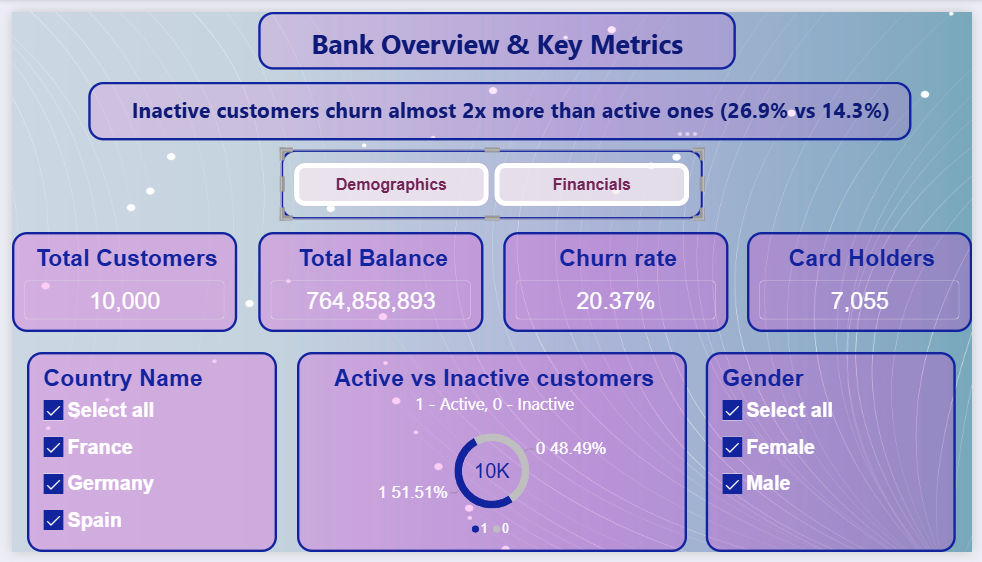
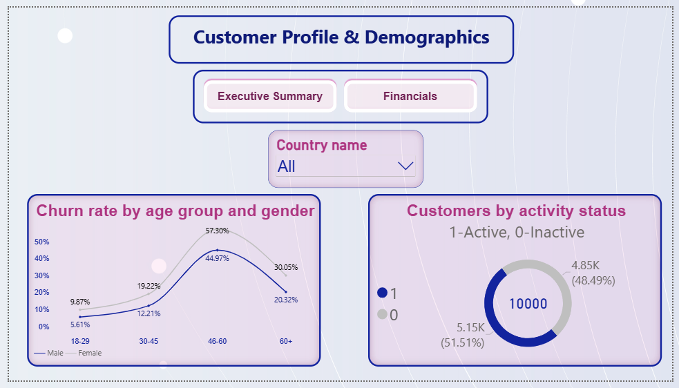
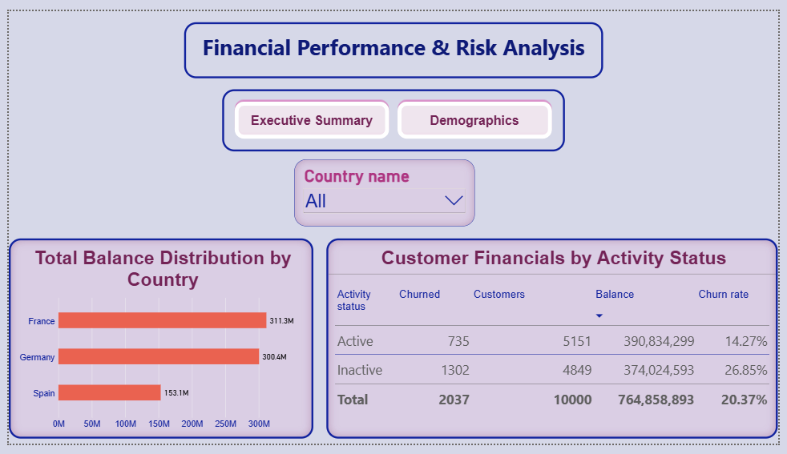

# Bank Customer Churn Analysis & Risk Analytics (SQL + Power BI)

## About the Project
I have a background in banking, so I chose a real business problem: **why do customers leave, which segments are at risk, and how do activity, age and balances affect their decision?**
I built a normalized PostgreSQL data model, wrote SQL queries for the analysis, and created a 3-page Power BI dashboard for decision-making.

**Dataset:** 10,000 bank customers (France, Germany, Spain).

## Key Insights
- **Overall churn rate is 20.37%** (2,037 of 10,000 customers left).
- **Inactive customers churn almost 2x more than active ones:** 26.85% vs 14.27%.
- **Age is a key risk factor.** Churn peaks in the **46–60 age group** (57.3% for women, 45.0% for men), while customers aged 18–29 are the most loyal (9.87% / 5.61%).
- **Women churn more than men in every age group.**
- **Inactive customers are 48.5% of the customer base and hold about 49% of total balances** (374M of 765M), a large pool of balances to protect through reactivation.
- France and Germany each hold about 300M+ in balances, Spain about 153M.

## Business Recommendations
1. Launch a **reactivation campaign** for inactive customers, the group with the highest churn.
2. Build a **retention offer for customers aged 46–60**, especially women.

## Dashboard

## Tech Stack & Skills
- **Database:** PostgreSQL
- **SQL:** multi-table JOINs, CASE WHEN, aggregations, subqueries, Window Functions (RANK, AVG OVER PARTITION BY), data normalization
- **Power BI:** data modeling, DAX measures (Churn Rate), age-group buckets, slicers and page navigation

## Data Model
Normalized into connected tables: `customers`, `bank_accounts`, `geography` (loaded from the raw `churn_modelling` table).

## Files
- `Bank_churn.sql`: schema, data loading and 11 analysis queries
- `PortFolio_Bank_Customer_Analytics.pbix`: Power BI dashboard (open in Power BI Desktop)

## Also Available on GitLab
🔗 [gitlab.com/galstyan.nhayana/bank-churn-sql](https://gitlab.com/galstyan.nhayana/bank-churn-sql)
